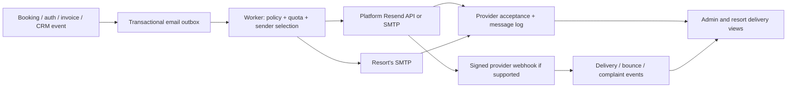

# ResortPro Email Delivery & SMTP — Master Plan

**Status:** Proposed development plan · **Owner decision required:** launch quotas and pricing · **Prepared:** 29 October 2026

## 1. উদ্দেশ্য

ResortPro-র email শুধু marketing feature নয়। Account verification, password reset, booking confirmation, invoice ও guest communication নির্ভরযোগ্যভাবে না গেলে user account বা resort-এর দৈনন্দিন কাজ আটকে যেতে পারে।

এই plan-এর লক্ষ্য:

1. Super Admin যেন নিজের email provider বা SMTP configure ও monitor করতে পারেন।
2. প্রতিটি resort তার নিজের SMTP account connect করতে পারে, অথবা ResortPro-র email service ব্যবহার করতে পারে।
3. ResortPro-র সব public plan-এ প্রয়োজনীয় platform email সুবিধা দেওয়া; higher plan-এ বেশি usage এবং admin-controlled allowance রাখা।
4. Queued, accepted, delivered এবং failed—এই অবস্থাগুলো সঠিকভাবে দেখানো; ভুল করে “sent” না বলা।
5. গুরুত্বপূর্ণ transactional email-কে marketing bulk mail থেকে আলাদা priority এবং protection দেওয়া।

**এই document একটি প্রস্তাব; quota/price এখনও অনুমোদিত ব্যবসায়িক সিদ্ধান্ত নয়।** কোনো production credential, live mail বা payment change এই planning task-এর অংশ নয়।

## 2. সহজ ভাষায়: SMTP ও email কীভাবে কাজ করে

- **Email provider:** যে service বাস্তবে অন্যের mailbox-এ email পৌঁছানোর চেষ্টা করে—যেমন Resend বা অন্য SMTP provider।
- **SMTP:** provider-এর সাথে email পাঠানোর একটি standard protocol। Host, port, username এবং password বা app password দরকার হয়।
- **Resend API:** SMTP ছাড়াও Resend-এর নিজস্ব API দিয়ে mail পাঠানো যায়। আমাদের বর্তমান app এই পথ ব্যবহার করে।
- **From:** receiver যে sender address দেখেন; এটি provider/domain-এর নিয়ম অনুযায়ী অনুমোদিত হতে হবে।
- **Reply-to:** guest reply করলে resort-এর কোন email-এ যাবে। এটি From-এর সঙ্গে এক হওয়া বাধ্যতামূলক নয়।
- **SPF / DKIM / DMARC:** domain থেকে mail পাঠানোর অনুমতি ও authenticity বোঝাতে DNS-এ রাখা নিয়ম। এগুলো সঠিক না হলে email reject বা spam-এ যেতে পারে।

একটি provider-এর SMTP account configure করা মানে ResortPro নিজে mail server চালাচ্ছে না। Super Admin provider account configure করবেন; SMTP/API provider delivery করবে।

## 3. বর্তমান অবস্থা — repository inspection

| বিষয় | বর্তমান evidence |
|---|---|
| Platform sender | `apps/api/src/services/email.ts` থেকে Resend API; `RESEND_API_KEY` এবং `EMAIL_FROM` environment variable। |
| SMTP | `nodemailer` dependency আছে, কিন্তু SMTP `createTransport` এবং per-tenant SMTP settings ব্যবহার পাওয়া যায়নি। |
| Local testing | `docker-compose.yml`-এ Mailpit আছে; বর্তমান sender সেটির SMTP port-এ wired নয়। |
| Resort settings | `EmailSettings`-এ confirmation, pre-arrival, checkout, cancellation toggle, reply-to ও footer আছে; transport configuration নেই। `apps/api/src/routes/tenants.ts` এবং dashboard settings page দেখুন। |
| Send failures | `sendEmail()` `{id, error}` return করে; কিছু callers সেই error পরীক্ষা না করেই success দেখায় বা background promise resolve করে। Guest email tracker শুধু rejected promise ধরতে পারে। |
| Checkout email | `sendCheckoutEmail`-এ `invoiceSentAt` claim আছে; provider returned error throw না হলে claim সফল send হিসেবে রয়ে যাওয়ার ঝুঁকি আছে। |
| Trial/automation | Trial stage আগে claim করে; result পরীক্ষা না করলে failed send-ও completed হিসেবে গণনা হতে পারে। CRM/automation-এর `EmailSend` record আছে, তবে সব transactional message-এর জন্য নেই; automation failed result সত্ত্বেও sequence advance করে। |
| Background process | `apps/api/src/worker.ts` reminder ও automation cron চালায়। Worker সত্যি live আছে এবং API key valid কি না এই plan-এ independently verify করা হয়নি। |
| Status / webhook | CRM schema-তে delivered/bounced/opened fields আছে; বর্তমান code-এ Resend delivery webhook পাওয়া যায়নি। Generic SMTP-তেও delivery feedback automatic ধরে নেওয়া যাবে না। |
| Plans | `packages/types/src/plans.ts`: Solo internal `FREE`, Independent Resort `STARTER`, Resort Group `PROFESSIONAL`; legacy `ENTERPRISE`। Internal enum `FREE` মানে free-forever plan নয়। |

Prior review-এর local environment check-এ API key placeholder পাওয়া গিয়েছিল; এটি তখনকার local state, production status-এর প্রমাণ নয়। Live provider credentials, domain verification, actual deliverability ও deployed worker status এখনও **unverified**।

## 4. প্রস্তাবিত product সিদ্ধান্ত

### 4.1 দুই ধরনের sender

| Sender | কার জন্য | নিয়ন্ত্রণ |
|---|---|---|
| **ResortPro system sender** | Account verification, password reset, staff invite, security, subscription ও platform notifications | শুধু Super Admin; সর্বদা platform provider। Tenant SMTP বা tenant quota-এর ওপর নির্ভর নয়। |
| **Resort guest sender** | Booking, pre-arrival, checkout/invoice, cancellation, guest-facing report/CRM ও permitted campaigns | Resort owner বেছে নেবেন: **ResortPro email service** অথবা **Connect your SMTP**। |

Owner settings-এ default থাকবে **Use ResortPro email service**। কোনো technical setup ছাড়াই শুরু করতে পারবেন। Subject/body-তে resort name দেখানো হবে, কিন্তু From হবে platform-এর verified sender; resort-এর verified/valid email হবে Reply-to। Resort-এর নিজের domain থেকে From দেখানোর জন্য ওই domain ও provider কীভাবে authorise করতে হয় তা আলাদাভাবে verify করতে হবে—unverified address spoof করা যাবে না।

Resort নিজস্ব SMTP বেছে নিলে সেই provider-এর নিয়ম মেনে From address সেট করবে। Resort-এর contact email-এ সত্যিই reply পাঠানোর জন্য SMTP/Resend message header-এ `replyTo` দিতে হবে; শুধু template footer-এ address দেখানো যথেষ্ট নয়।

### 4.2 Plan ও quota — প্রয়োজনীয় email যেন হারিয়ে না যায়

সবার জন্য অন্তর্ভুক্ত platform service ও নিজের SMTP option দেওয়ার প্রস্তাব। Higher plan-এ বেশি platform allowance থাকবে। Actual amounts provider cost, expected tenant volume ও owner approval-এর পরে নির্ধারণ হবে। নিচের সংখ্যা **কেবল বাজেট মডেলিং উদাহরণ, প্রতিশ্রুত plan benefit নয়**:

| Current customer-facing plan | Example monthly platform marketing allowance | Own SMTP |
|---|---:|---|
| Solo (`FREE` internal key) | 100 recipient messages | Available; actual plan permission to be approved |
| Independent Resort (`STARTER`) | 500 recipient messages | Available |
| Resort Group (`PROFESSIONAL`) | 2,000 recipient messages | Available; property-level assignment policy below |
| Enterprise/custom | Contract-based | Available |

**Important:** বর্তমান `PLAN_FEATURES`-এ Solo-এর marketing flag নেই। এই table সেই flag silently চালু করে না। Basic guest transactional email সব plan-এ available হবে; campaign/CRM feature access ও own SMTP access সম্পর্কে existing entitlement-এর সাথে product owner-এর অনুমোদিত policy নির্দিষ্ট করতে হবে। Plan থেকে feature remove করা যাবে না।

Counting rules:

- Platform quota **per recipient** গণনা: To/CC/BCC-র প্রতিটি distinct accepted recipient একটি usage unit। Prefer one recipient per message so status এবং privacy পরিষ্কার থাকে।
- Quota period: tenant billing cycle যদি reliably available হয় সেটি; না হলে UI-তে স্পষ্ট দেখানো fixed UTC calendar month। Multiple properties same tenant-এর shared pool; super-admin override আলাদা audited record। Never silently change reset rule mid-cycle.
- Authentication/security এবং required platform account mail tenant quota-র বাইরে; platform-wide abuse/rate controls থাকবে।
- Guest booking/invoice/cancellation transactional mail-এর জন্য protected reserved capacity রাখুন। Marketing allowance শেষ হলেও critical message deny করবেন না; soft threshold + alert, reasonable emergency reserve ও abuse cap থাকবে। Reserve-ও exhausted হলে message durable `WAITING_CAPACITY`-তে রেখে owner/admin alert ও manual recovery; কোনো mail “sent” বলবেন না।
- Marketing quota শেষ হলে নতুন campaign pause হবে; কোন date-এ reset এবং কীভাবে own SMTP/plan options দেখা যায় UI-তে দেখাবে। Auto-upgrade বা surprise charge নয়।
- SMTP নিজের provider দিয়ে পাঠালে provider-এর নিজস্ব limit/cost applies; ResortPro delivery count ও anti-abuse limit তবুও রাখবে, platform quota consume করবে না।
- Count platform usage on provider **acceptance**, not each retry attempt; reserve capacity atomically before send, reconcile failed/unknown outcomes. Prevent concurrent oversubscription. Mark estimated cost separately; never auto-bill without a future approved billing design.
- Show warning at 80% / 100% of marketing allowance and admin cost/abuse dashboard; these percentages are proposed product defaults, not guarantees.

### 4.3 Failure, fallback এবং consent

- Guest chooses own SMTP → keep using it for that tenant's resort-origin mail; explicit connection status দেখাবে।
- SMTP authentication/TLS failure হলে credentials fix করতে বলবে; temporary failures retry হবে; message queued থাকবে।
- **No silent fallback** to platform sender: এতে From/branding, privacy ও quota বদলে যেতে পারে। Resort owner চাইলে settings-এ opt in করে **critical transactional only** fallback enable করতে পারবেন; default off। Fallback sends use platform verified From, configured Reply-to, and are clearly logged/notified.
- Timeout after provider may have accepted a message = `UNKNOWN`, not safely `FAILED`. Avoid automatic cross-provider fallback or retry that could duplicate sensitive mail; reconcile using provider message ID/logs where available and expose a manual action.
- Platform system email কখনো tenant SMTP-তে যাবে না। Failing provider-এর বিষয়ে alert in dashboard/log/other configured channel; same broken email transport দিয়ে alert পাঠানোই একমাত্র পথ হবে না।

## 5. Super Admin UX

Add **Super Admin → Settings → Email Delivery**:

1. Select provider: **Resend API** or **SMTP**. Preserve current Resend setup by default. Display configuration source (environment or admin-managed) and status.
2. SMTP: host, port, connection security (`TLS/SSL` on 465; `STARTTLS` on 587 or provider-supported port), username, password/app password, From name/address, reply-to.
3. Resend API: masked API key, verified platform From address, optional reply-to; webhook signing secret stored separately.
4. **Test connection** checks DNS, network, TLS and authentication; **Send test email** explicitly sends to an admin-selected address and shows provider acceptance. Deliverability is a separate outcome.
5. Save draft → test → activate. A bad draft never replaces a working active configuration. Rotation/revoke/reset admin actions audited without secrets.
6. Operational dashboard: pending, accepted, delivered where supported, failed, bounced/complained, unknown; per-provider and per-tenant usage, backlog age, quota status, and worker/last-success indicators.
7. Configure plan allowances, reserve and selected per-tenant exception with audit. No automatic plan/price changes.
8. Restrict credentials and changes to actual `SUPER_ADMIN` authorisation; standard admin roles may view only a safe status if allowed. Add confirmation for enabling fallback or disabling a live provider.

## 6. Resort Owner UX

Under **Dashboard → Settings → Email** keep existing four lifecycle toggles and add:

- **How would you like to send emails?** `Use ResortPro` / `Connect your email`.
- Friendly setup wizard for SMTP provider, From name/email, Reply-to, host, port, security, username, app password. Provide provider-specific help as documentation, not assumptions; e.g. Gmail app passwords require the provider's account prerequisites. OAuth is a future option, not required for v1.
- Clear statuses: `Not connected`, `Connection verified`, `Test accepted`, `Needs attention`. Never show verified inbox delivery just from a connection test.
- Password field shows “Saved”; blank means keep existing secret; offer explicit replace/delete actions. No GET response ever contains secret or reversible masked secret.
- Test connection and separately send an explicit test email to an owner-selected address, with rate limits.
- Delivery list: booking confirmation, reminders, cancellation, invoice, etc.; only this tenant's records, restricted to owner/manager. Status plus actionable error, timestamps and safe retry controls.
- Allow owner to switch back to platform sender without deleting saved SMTP until explicitly requested. Pending messages retain a documented routing/config version; changing provider does not silently duplicate messages.
- Plan usage card: amount used, reset date, transactional reserve status and provider limits. Explain when own SMTP cost is paid directly to their provider.
- Resort Group: v1 tenant-level SMTP identity. A per-property SMTP override is a later enhancement; show which properties inherit the tenant sender. Do not promise per-property support before built.

## 7. Technical architecture & data flow



### 7.1 Service contract

Replace direct calls to `sendEmail()` with one central facade, gradually:

```ts
type EmailCategory = 'SYSTEM' | 'TRANSACTIONAL' | 'MARKETING';
type EnqueueEmail = {
  tenantId?: string; // required except genuinely platform-wide messages
  category: EmailCategory;
  kind: string;
  dedupeKey: string; // stable business event + recipient
  recipient: string;
  subject: string;
  templateRef: string;
  payloadRef: string; // minimised, access-controlled / encrypted as needed
  replyTo?: string;
};
```

- Business routes write a durable outbox record within the same DB transaction as the booking/invoice/account event when practical; post-commit worker handles provider interaction. No network call inside business transaction.
- `enqueue()` returns `queued` with message ID, not `sent`. User-triggered send APIs show `Queued` until provider acceptance.
- Worker chooses system or tenant transport using category + tenant settings + entitlement + verified sender + quota. Validate `tenantId` on every lookup and worker read. No cross-tenant config or logs.
- Define `EmailTransport` adapters: `send`, `verifyConnection`, optional provider webhook capabilities. Implement Resend API adapter (existing), SMTP adapter (Nodemailer already in dependencies), and development Mailpit SMTP adapter. Keep provider error shape structured and sanitised; no catch-and-ignore.
- Determine config precedence: environment-configured Resend bootstrap until admin activates a tested DB-stored provider; the admin UI states the active source. Live key rotation must be available without redeploy and be versioned/cache-invalidated across API and worker. No admin secret returned to UI.
- Keep system mail on a separately configured platform provider or logically isolated sender/capacity; reserve is not shared with campaigns. Separate sending subdomains/provider streams for transactional and marketing where supported, after explicit domain DNS setup. A subdomain alone does not automatically isolate Gmail's primary-domain bulk-sender classification.

### 7.2 Suggested schema (validate against current Prisma before implementing)

Prefer additive models/migrations, not destructive edits to current `EmailSettings` or `EmailSend`:

- `PlatformEmailProvider`: active/draft, provider type, config version, verified From, encrypted secret reference, timestamps and actor.
- `TenantEmailProvider`: unique tenant, mode, host/port/TLS, From/Reply-to, encrypted credentials, status, version, explicit fallback consent; don't store credentials in public `PlatformSettings` JSON.
- `EmailMessage`: tenantId nullable only for platform-wide events, category/kind, recipient, stable business idempotency key, provider/config version, status, priority, timestamps, provider ID, retry count, last sanitized error, correlation ID, expiry and retention metadata.
- `EmailAttempt`: message ID, attempt number, provider, result, safe provider response, start/end, next attempt; never message body/secrets.
- `EmailProviderEvent`: provider event ID unique, signature verification result, provider message reference, timestamp, event type, minimal safe metadata; map event to correct tenant via stored message ID.
- `EmailUsagePeriod` / `EmailQuotaReservation`: per-tenant, period, category/provider, reserved/accepted/adjusted usage and audit. Unique keys and transactions must prevent concurrent oversubscription.
- `EmailSuppression`: address keyed by appropriate tenant/provider and reason (bounce, complaint, unsubscribe), tenant-aware policy and retention. Security/account mail must not blindly bypass an address known invalid; show recovery guidance.

Track message states as `QUEUED → PROCESSING → ACCEPTED → DELIVERED` where delivery evidence exists; also `RETRY_WAIT`, `FAILED`, `BOUNCED`, `COMPLAINED`, `SUPPRESSED`, `WAITING_CAPACITY`, `UNKNOWN`. Generic SMTP normally establishes only **accepted by SMTP server**, not inbox delivery; show `Delivery status unavailable` unless that provider supplies a verified event.

### 7.3 Retry and deduplication

- Database uniqueness on business-event key plus recipient stops duplicate enqueue; worker claims with lease/locking, heartbeat and recovery after process death.
- Retry transient 4xx/provider 429/5xx, network and timeout errors with exponential backoff, jitter, max attempts and age/dead-letter alert. Authentication, policy or bad-address permanent errors need correction rather than endless retry.
- Resend API supports an idempotency key for a finite provider window (currently 24 hours); reuse the same key and payload on retry inside that window, and keep our own longer-lived record. SMTP has no universal idempotency guarantee: stable Message-ID is correlation, not deduplication proof.
- A provider timeout after sending may have accepted a message. Mark `UNKNOWN`; require reconciliation before a repeated send or fallback. Never promise exactly-once delivery.
- Checkout invoice finalisation must commit first, then enqueue from the committed invoice of record. Replace the current premature `invoiceSentAt` claim with state that distinguishes queued / accepted / delivered; reconcile existing rows conservatively.
- Trial stages and CRM sequence steps should not advance as if delivered on provider error. Use outbox dedupe and explicit state transitions; marketing logic may have a deliberate skip/dead-letter decision after retries.

### 7.4 Delivery events and consent

- For Resend, add a raw-body webhook endpoint, verify signature using webhook secret, validate timestamp/replay, deduplicate provider event ID, and handle out-of-order events without reverting terminal states. Map each provider message to its own tenant.
- Record accepted, delayed, delivered, bounced, complained and suppressed when provider supplies them. Provider `delivered` means receiving server accepted mail, not proof of inbox placement or that a human read it.
- Generic SMTP has no universal event webhook. If no provider integration exists, expose only provider accepted/unknown and provide instructions to inspect provider logs; do not fabricate delivery/open rates.
- Marketing only: verified consent/opt-out, visible unsubscribe and one-click headers where required, suppression for complaints/hard bounce; transactional account/booking notices use appropriate separate rules. Apply per-tenant sender/rate controls to protect the shared platform domain.

## 8. Security requirements for user-provided SMTP

User-supplied SMTP host makes the API/worker an outbound network client and creates an internal-network access risk. This is a release blocker, not optional polish.

1. Production allow explicit SMTP ports 465, 587 and 2525 initially; allow a custom port only through a reviewed admin policy. Deny port 25 by default. Connection/auth/read timeouts and strict concurrency limits.
2. Resolve all A/AAAA addresses and block loopback, RFC1918/private, link-local, multicast, unspecified, reserved and cloud metadata networks, including IPv4-mapped IPv6; block local hostnames and IP literals where unnecessary. Revalidate DNS for each attempt and pin the actual socket to the validated IP; retain hostname for TLS SNI/certificate verification. DNS rebinding / IPv6 / mixed public-private answers must not bypass checks.
3. Prefer outbound network firewall/egress proxy enforcing the same policy. Verify design works with Nodemailer DNS/socket hooks; do not assume existing HTTP-only `safe-url.ts` secures SMTP connections.
4. Enforce TLS certificate verification: implicit TLS or required STARTTLS in deployed environments. No `rejectUnauthorized: false`, opportunistic plaintext fallback or plaintext production credentials. Local Mailpit insecure mode is allowed **only** via explicit development/test configuration, never tenant-controlled production bypass.
5. Passwords/API keys encrypted at rest using established, reviewed authenticated encryption or a secrets manager; encryption key stored separately from database, versioned and rotatable. A schema comment saying “encrypted” is not evidence of an existing safe implementation—inspect/reuse only a verified helper; fail closed if key absent.
6. Mask secrets in UI, API response, application logs, traces, audit events, error details and analytics. Restrict read/decrypt to the worker/provider service; backups contain encrypted values and must be protected.
7. Audit who changed, tested, activated, disabled, or deleted a provider; log metadata only. Tenant credential rotation cannot expose another tenant's values.
8. Limit test-send recipients and frequency to prevent relay abuse, header injection, open relay and account enumeration. Validate addresses, input lengths, sender domain and attachment policy. Enforce SMTP server `From` authorization and sender-domain alignment; do not accept raw arbitrary headers from client.
9. Data retention and erasure: store minimal message metadata, encrypt any needed rendered content, expire password-reset content before token expiry, restrict operators' access, and delete/anonymize tenant records under existing deletion workflows. Preserve legal/audit records only per approved retention policy.

## 9. API and integration points

Final names may follow repo conventions; these are proposed contracts:

| Route | Access | Purpose |
|---|---|---|
| `GET /api/admin/email/provider` | Super Admin | Safe platform status and masked config. |
| `PUT /api/admin/email/provider/draft` | Super Admin | Save encrypted draft; never echo secret. |
| `POST /api/admin/email/provider/test-connection` | Super Admin | Verify host/TLS/auth only. |
| `POST /api/admin/email/provider/test-send` | Super Admin | Explicit test message; return accepted/queued state. |
| `POST /api/admin/email/provider/activate` | Super Admin | Atomically activate tested config version. |
| `GET/PATCH /api/tenant/email-provider` | Owner; safe status optionally Manager | Tenant transport and non-secret settings; server derives tenantId. |
| `POST /api/tenant/email-provider/test-connection` | Owner | Network/TLS/auth check only. |
| `POST /api/tenant/email-provider/test-send` | Owner | Rate-limited test to selected recipient. |
| `GET /api/tenant/email-deliveries` | Owner/Manager | Tenant-scoped metadata/status, pagination. |
| `POST /api/tenant/email-deliveries/:id/retry` | Owner/Manager | Explicit safe retry only when status permits; deny UNKNOWN until reconciled. |
| `POST /api/webhooks/email/resend` | Provider signature | Verify raw-body signature; no tenant-controlled identity. |

Existing `GET/PATCH /api/tenant/email-settings` stays compatible for lifecycle toggles; migrate `POST .../test` response away from unconditional `sent: true`.

Likely files: `apps/api/src/services/email.ts`, `apps/api/src/utils/guest-emails.ts`, `apps/api/src/services/{automation,trial-emails}.ts`, `apps/api/src/jobs/pre-arrival-reminder.ts`, `apps/api/src/routes/{auth,bookings,website,invoices,reports,staff,tenants,crm,admin}.ts`, `apps/api/src/worker.ts`, `packages/database/prisma/schema.prisma`, migration files, `packages/types/src/plans.ts` plus entitlement logic, dashboard settings and admin settings pages, `apps/web/src/lib/api.ts`, deployment compose/env documentation and targeted tests. Current working-tree changes must be preserved when implementation starts.

## 10. Migration and rollout — local → dev → main

1. **Inventory & baseline:** classify every current caller as SYSTEM / TRANSACTIONAL / MARKETING, recipient, tenant, existing failure semantics, optional side effects. Document current deployment configuration and verify worker status without exposing secrets.
2. **P0 safety patch:** fix returned-error handling and false success; correct checkout claim and trial/automation failure states. Implement targeted tests before UI expansion. Password-reset endpoint can keep a generic anti-enumeration response but internally log/alert failures; never disclose account existence.
3. **Outbox foundation:** additive schema + central facade + worker lease/recovery + status/attempt logs; use existing Resend adapter as default and migrate critical paths incrementally. Backfill historical logs only where verifiable; mark unknown, never claim delivered without evidence.
4. **Local SMTP testing:** Mailpit adapter behind development-only switch; verify rendered content, From/Reply-to and failures. `RESEND_API_KEY` placeholder remains safe for local development; no real customer email is sent.
5. **Admin provider controls:** draft/test/activate, SMTP and Resend API, scoped auth, secret encryption, SSRF controls and rate limiting. Env bootstrap fallback retained until deliberately activated.
6. **Tenant SMTP:** tenant-scoped settings and optional consent-based fallback; rollout behind feature flag for selected test tenants. Verify provider hostname restrictions and SMTP timeout/unknown handling.
7. **Usage and policies:** quota reservations, protected transactional capacity, marketing limits, controls and notifications. Choose launch numbers and pricing only after cost modelling and owner approval.
8. **Resend event tracking:** webhook signature/replay protection, per-recipient events and suppression; build delivery UI with SMTP limitations clearly labelled.
9. **Pilot on `dev` staging:** start with synthetic tenant and Mailpit, then a controlled, explicitly authorised real inbox and provider. Check account flow, booking, invoice, reminder, campaign, failure, tenant isolation and rollback. Observe queue and worker before considering `main`.
10. **Production promotion:** follow existing project workflow local test → push `dev` → verify dev server → promote to `main` only after results. Enable behind feature flags, start with platform sender, then opt-in tenants. Monitor queue age, accepted/error rates, bounce/complaint and provider cost.

Rollback: feature flag can route new platform mail to the previous Resend adapter; stop new tenant SMTP activation, keep durable messages and audit state intact. Do not automatically resend `UNKNOWN` or purge queued messages. Schema migrations additive; never roll back data destructively.

## 11. Test plan and acceptance criteria

| Scenario | Expected |
|---|---|
| Provider API key missing/rejected | Explicit failure/queued status with alert; UI never says delivered/sent. |
| Valid platform Resend | Provider acceptance recorded, provider ID stored; delivered only on verified event. |
| Local Mailpit | A synthetic booking/test mail appears in Mailpit; no external email. |
| Platform system auth mail | Uses platform provider even when tenant custom SMTP is configured or tenant marketing quota is exhausted. |
| Tenant A custom SMTP / tenant B platform | Each uses only own transport, From, credentials and logs; cross-tenant access denied. |
| Wrong SMTP password, bad TLS cert, unavailable host | No insecure downgrade; actionable failure; retry only where appropriate. |
| SMTP DNS rebinding, private IPv4/IPv6, metadata, forbidden ports | Connection denied at resolution and connection time, including retries. |
| Test connection succeeds | UI says connection verified only; test send and delivery are separate. |
| SMTP timeout after potential acceptance | `UNKNOWN`; no silent resend/fallback; operator reconciliation. |
| Provider accepted then worker crashes | Lease recovery and idempotency do not silently create duplicate; ambiguous SMTP handled explicitly. |
| Duplicate / out-of-order / forged webhook | Verify raw signature; ignore duplicates and invalid events; never cross tenant or regress status. |
| Booking event + rollback | Transaction rollback creates no outbox message; committed event creates one logical record. |
| Checkout invoice | Uses committed invoice amount, failed send not recorded as sent, duplicate processing safe. |
| Trial and CRM failure | No false sent log/sequence advance; retry or explicit failure handling. |
| 80% / 100% marketing quota | Warning then paused marketing; critical transactional reserve stays available and accurately counted. |
| Concurrent 2 workers | Atomic lease/quota reservations prevent duplicate enqueue and quota overspend. |
| Own SMTP fallback off/on | Off: no provider switch. On: only authorised critical mail falls back with platform From and audit. |
| Hard bounce, complaint, unsubscribe | Marketing suppression respected; dashboard shows appropriate status. |
| Secret saved/replaced/deleted | GET never returns secret; logs scrubbed; no cross-tenant exposure; rotation takes effect on worker. |
| Accessibility / mobile | Keyboard labels, validation, errors and provider settings remain usable in light/dark mode. |

Test at unit + integration level with fake provider responses, real local Mailpit, fake SMTP server for error cases, provider-signed webhook fixtures, and Playwright settings flow. A real external inbox test is separate and requires an explicitly designated recipient and configured provider; provider acceptance is not inbox verification.

## 12. Decisions and dependencies before implementation

- **Owner decision:** actual included marketing allowance, transactional reserve, own-SMTP access per plan, per-property overrides, and any future paid add-on. Proposed numbers above are not launch pricing.
- **Owner decision:** whether fallback consent is enabled per resort and which critical categories qualify; default off.
- **Ops:** select transactional/marketing sending domains, verify SPF/DKIM/DMARC and provider account limits, set secure key storage and egress firewall.
- **Product/engineering:** choose retention period, incident response contacts, allowed providers/ports, exact email status vocabulary, and quota billing-period definition.
- **Dependency:** checkout invoice email consumes final invoice of record; coordinate with [`billing-contract.md`](./billing-contract.md) and [`checkout-billing-completeness.md`](./checkout-billing-completeness.md). Do not assume plan status proves implementation status—inspect current code/tests.
- **Not in v1:** inbound mailbox hosting, automatic parsing of replies, arbitrary bulk cold outreach, automatic paid overages, OAuth connection flow, and guaranteed exactly-once delivery.

## 13. Research sources

1. [Nodemailer SMTP transport and verification](https://nodemailer.com/smtp) — TLS/STARTTLS configuration and the limitation of `verify()`.
2. [Google sender guidelines](https://support.google.com/mail/answer/81126?hl=en) — authentication, TLS and bulk sender/unsubscribe requirements.
3. [Resend idempotency keys](https://resend.com/changelog/idempotency-keys) — supported key and 24-hour provider retention.
4. [Resend webhook signature verification](https://www.resend.com/changelog/managing-webhooks-via-api) — raw-body and signature verification.
5. [OWASP SSRF prevention](https://cheatsheetseries.owasp.org/cheatsheets/Server_Side_Request_Forgery_Prevention_Cheat_Sheet.html) — DNS rebinding and connection-time destination validation.
6. [OWASP secrets management](https://cheatsheetseries.owasp.org/cheatsheets/Secrets_Management_Cheat_Sheet.html) — secret encryption, access control, rotation and log hygiene.
